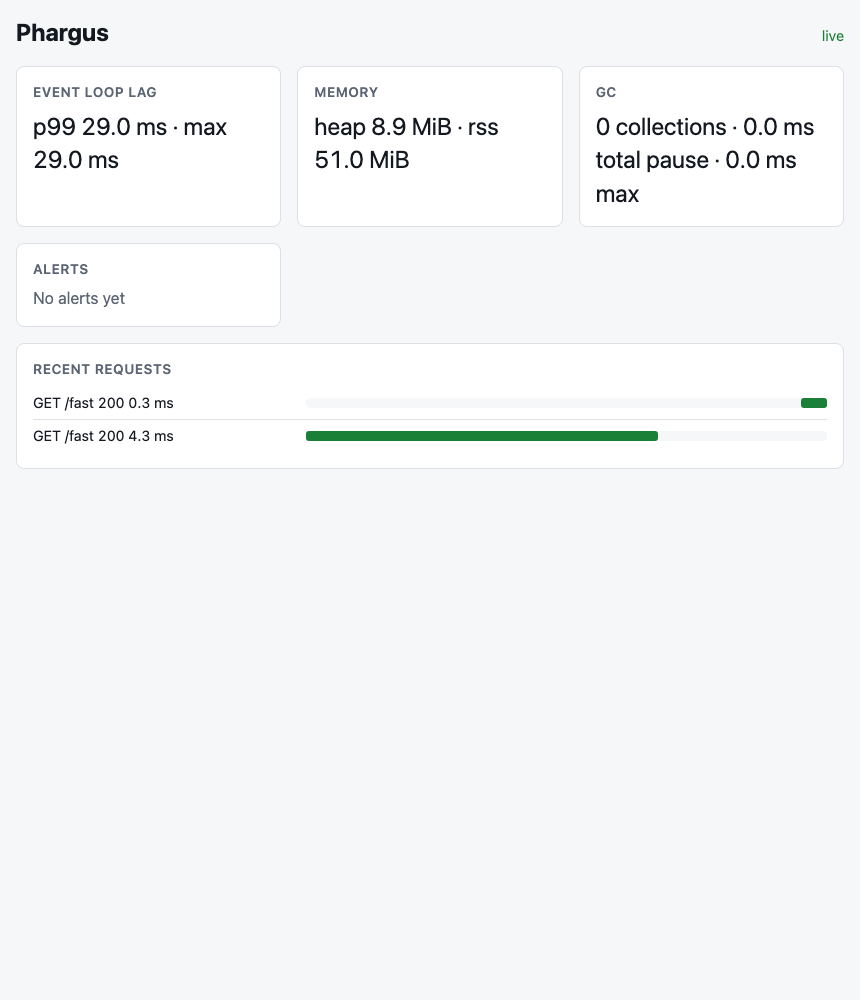
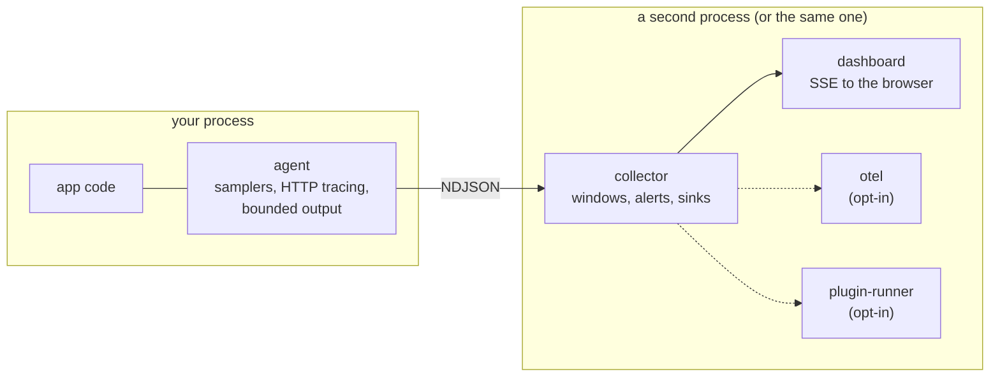

<p align="center">
  
</p>

<h1 align="center">Phargus</h1>

<p align="center"><strong>All-seeing runtime diagnostics for Node.js.</strong></p>

<p align="center">
  One line in your process. Event loop lag, memory, GC, stream backpressure and request traces.<br>
  Zero dependencies in the agent, no hosted account, no separate backend.
</p>

<p align="center">
  <a href="https://www.npmjs.com/package/@pharn-dev/phargus"></a>
  <a href="https://github.com/pharn-dev/phargus/actions/workflows/ci.yml"></a>
  <a href="https://github.com/pharn-dev/phargus/actions/workflows/codeql.yml"></a>
  <a href="https://github.com/pharn-dev/phargus/actions/workflows/gitleaks.yml"></a>
  <a href="./LICENSE"></a>
  <a href="./package.json"></a>
</p>

```bash
npm install @pharn-dev/phargus
node --import @pharn-dev/phargus/agent app.mjs | npx phargus serve
```

<p align="center">
  
</p>

> **Status: 0.1.0, the first release, is on npm.** Roadmap steps S0 to S7 are implemented (agent,
> collector, dashboard, tracing, V8 and memory depth, plugin runner, OpenTelemetry export; see
> [`ROADMAP.md`](./ROADMAP.md)).

## Contents

- [Why Phargus](#why-phargus)
- [Quick start](#quick-start)
- [Configuration](#configuration)
- [What you get](#what-you-get)
- [How it fits together](#how-it-fits-together)
- [Safety and limits](#safety-and-limits)
- [Documentation](#documentation)
- [Contributing](#contributing)
- [Security](#security)
- [License](#license)

---

## Why Phargus

Phargus is for a quick look at a live process: one line, in-process, no account.

|                     | One-line setup | Runs in the live process | Needs an account  | Analysis              |
| ------------------- | -------------- | ------------------------ | ----------------- | --------------------- |
| [clinic.js][clinic] | no             | one-shot capture         | no                | offline, after        |
| OpenTelemetry       | no             | yes                      | no, but a backend | in your backend       |
| Hosted APMs         | yes            | yes                      | **yes**, and paid | in the vendor's UI    |
| **Phargus**         | **yes**        | **yes**                  | **no**            | live, in your browser |

The agent's zero-dependency rule is never relaxed: `src/agent` imports Node core only, and an ESLint
rule enforces it.

[clinic]: https://clinicjs.org/

---

## Quick start

**Requires Node.js 22.18 or newer** (`engines.node` is `>=22.18.0`; [`.nvmrc`](./.nvmrc) pins the
tested floor). On Node 22, request tracing is noticeably more expensive for promise-heavy code than
on Node 24; see [`docs/LIMITS.md`](./docs/LIMITS.md#1-cost-and-overhead).

Two commands: install the package, then run your app with the agent and pipe its output into
`phargus serve`.

```bash
npm install @pharn-dev/phargus
node --import @pharn-dev/phargus/agent app.mjs | npx phargus serve
```

`phargus serve` prints `phargus: dashboard at http://127.0.0.1:7070` on stderr; open that address.
Your app's stdout is the pipe, so it may log there too: lines that are not agent data are skipped
and counted. When the app exits, the dashboard keeps serving what it collected until you press
Ctrl-C.

### Other ways to load the agent

For a CommonJS app, use `--require` instead of `--import`:

```bash
node --require @pharn-dev/phargus/agent app.js | npx phargus serve
```

Or load the agent in code, first, before your own code:

```js
// CommonJS
require('@pharn-dev/phargus/agent');

// ESM
import '@pharn-dev/phargus/agent';
```

By default the agent writes one sample line per second (about 2 KB) to **your process's stdout**,
plus one line per traced request. That is all the agent does on its own: it starts no server.
`phargus serve` (below), or a collector you wire yourself, turns that stream into the dashboard.

### The live dashboard

#### `phargus serve`

```text
phargus serve [options] [file|-]
```

| Option                 | Default     | Meaning                                                                    |
| ---------------------- | ----------- | -------------------------------------------------------------------------- |
| `--port <n>`           | `7070`      | Port to listen on, `0` to `65535`. `0` picks a free port.                  |
| `--host <address>`     | `127.0.0.1` | Address to bind. A non-loopback host needs a token.                        |
| `--token <value>`      | none        | Require a token. Prefer `PHARGUS_TOKEN`: a flag shows in the process list. |
| `--window-ms <n>`      | `1000`      | Aggregation window in milliseconds.                                        |
| `--max-line-bytes <n>` | `1048576`   | Longest accepted input line in bytes.                                      |
| `-h`, `--help`         |             | Print the usage text.                                                      |
| `-v`, `--version`      |             | Print the version.                                                         |

- **Input.** stdin by default (or `-`). Give a file path to replay a capture: redirect the app's
  stdout to a file, then run `npx phargus serve capture.ndjson`. The server keeps running after
  the input ends, serving what it collected, until you stop it.
- **Token.** On loopback no token is needed. For any other `--host` set one, with
  `PHARGUS_TOKEN=... npx phargus serve --host 0.0.0.0`; without it the command exits with code 2
  before binding. Set `PHARGUS_TOKEN` and `PHARGUS_DEBUG` on the `phargus serve` side of the pipe
  only: the agent warns about unknown `PHARGUS_*` variables in the app's own environment. See
  **Dashboard access** under [Using the library APIs](#using-the-library-apis) for how browsers
  and scripts present the token. The server answers only the `Host` names listed there and the CLI
  has no `allowedHosts` flag, so to reach it from another machine bind the address you will use
  (`--host 192.0.2.10`), or keep it on loopback behind an SSH tunnel.
- **Diagnostics go to stderr only.** The dashboard URL, a line when the input ends, and a
  `counts:` line (`decoder.invalid`, `decoder.oversized`, `collector.ignored`,
  `dashboard.droppedEvents`) when the input ends and again at exit. Errors print without a stack;
  set `PHARGUS_DEBUG=1` to get one.
- **Exit codes.** `0` for help, version and a graceful stop on `SIGINT` or `SIGTERM`; `1` for a
  runtime error (unreadable file, port in use) or a shutdown that did not finish in 5 seconds;
  `2` for a usage error (unknown flag, bad value, non-loopback host without a token).

#### Using the library APIs

To embed the collector and dashboard in your own process, wire `@pharn-dev/phargus/collector` and
`@pharn-dev/phargus/dashboard` yourself. A minimal version, which is what `phargus serve` does:

```js
// collect.mjs — run as: node --import @pharn-dev/phargus/agent app.mjs | node collect.mjs
import { pipeline } from 'node:stream/promises';
import { createCollector, createNdjsonDecoder } from '@pharn-dev/phargus/collector';
import { createDashboardServer } from '@pharn-dev/phargus/dashboard';

const collector = createCollector({ windowMs: 1000, capacity: 300 });
const dashboard = await createDashboardServer({ collector, host: '127.0.0.1', port: 7070 });
process.stderr.write(`phargus dashboard on ${dashboard.url}\n`);
const decoder = createNdjsonDecoder();
await pipeline(process.stdin, decoder, (records) => collector.consume(records));
```

Your app may write to the same stdout. Lines that are not JSON objects (plain text, truncated
lines) and lines longer than `maxLineBytes` (1 MiB by default) are skipped and counted as
`decoder.invalid` and `decoder.oversized`; JSON objects that are not agent records, such as the
lines of a JSON logger, and agent-shaped records that cannot be aggregated are skipped and counted
as `collector.ignored`. Neither is thrown. Pass `onSkipped` to `createNdjsonDecoder` or `onIgnored`
to `createCollector` to see each skipped line or record.

[`examples/express-app`](./examples/express-app) is the complete version: it forks the app, reads
its stdout into a collector with an alert rule, serves the dashboard, and shuts both down cleanly.
The recording above is that example.

**Dashboard access.**

- On a loopback address (`127.x.x.x`, `localhost`, `::1`) the token is optional. Binding any other
  address without a `token` is refused at startup.
- With a token, open `http://<host>:<port>/?token=<token>` once in a browser. The server answers
  with a redirect to `/` and an `HttpOnly`, `SameSite=Strict` cookie, so the token does not stay
  in the address bar or history. `?token=` is accepted on `/` only.
- Scripts and `curl` send `Authorization: Bearer <token>`, for example to `/events`.
- The server answers only requests whose `Host` is the bound address on the bound port (plus
  `localhost`, `127.0.0.1` and `[::1]` for a loopback or `0.0.0.0`/`::` bind); anything else gets
  `421`. A cross-origin `Origin` on `/events` gets `403`. Behind a reverse proxy, or when you
  reach the dashboard by another name, list that name in `allowedHosts`.
- The dashboard is plain HTTP. For remote access use an SSH tunnel or a TLS-terminating proxy.

---

## Configuration

Choose where the agent writes with `PHARGUS_OUTPUT`:

| Variable              | Default  | Meaning                                                   |
| --------------------- | -------- | --------------------------------------------------------- |
| `PHARGUS_OUTPUT`      | `stdout` | `stdout`, `none` (agent off), or a file path              |
| `PHARGUS_INTERVAL_MS` | `1000`   | sampling interval                                         |
| `PHARGUS_QUEUE_BOUND` | `1024`   | lines held per output queue before the oldest are dropped |
| `PHARGUS_ENABLED`     | `true`   | `false` or `0` turns the agent off                        |

The same keys (`output`, `intervalMs`, `queueBound`, `enabled`) can go in `phargus.config.json` or
`phargus.config.js` in the working directory. An unknown `PHARGUS_*` variable prints one warning on
stderr and is ignored. An invalid value disables the agent with one `[phargus] agent disabled: ...`
line on stderr; your app keeps running.

---

## What you get

| Capability          | What it covers                                                                                                                                                                                                                                                                                                                | Import                             |
| ------------------- | ----------------------------------------------------------------------------------------------------------------------------------------------------------------------------------------------------------------------------------------------------------------------------------------------------------------------------- | ---------------------------------- |
| **Runtime samples** | Event loop delay (min, max, mean, p50, p99); memory (`heapUsed`, `heapTotal`, `rss`, `external`, `arrayBuffers`); V8 heap space statistics; GC count, total and max pause and counts by kind                                                                                                                                  | `@pharn-dev/phargus/agent`         |
| **Backpressure**    | How often and how long writes stalled, grouped by the call site that wrote. Covers `Writable` subclasses, `fs.WriteStream`, `Duplex`, `Transform`, `PassThrough`, `net.Socket`, `tls.TLSSocket`, `http.ServerResponse` and `http.ClientRequest`                                                                               | `@pharn-dev/phargus/agent`         |
| **Request tracing** | Each request to a `node:http` or `node:https` server gets a trace id (or continues an incoming W3C `traceparent`), carried by `AsyncLocalStorage` with no change to your code. Spans record method, path without the query string, status and duration. `currentTraceId()` reads the id anywhere in that request's async work | `@pharn-dev/phargus/agent`         |
| **Loss accounting** | Output queues are bounded and drop the oldest lines; every sample line carries cumulative `dropped: { samples, spans }` counters                                                                                                                                                                                              | `@pharn-dev/phargus/agent`         |
| **V8 and memory**   | On-demand heap snapshots (`takeHeapSnapshot`); snapshot summaries, diffs and stack-trace symbolization in a Worker Thread pool; allocation sampling (`sampleAllocations`); a parser for `node --trace-deopt` output (`createDeoptParser`, you feed it the lines)                                                              | `@pharn-dev/phargus/analyzer`      |
| **Collector**       | Fixed time windows with integer math, threshold alerts, alert sinks (stdout, file, webhook), opt-in persistence of recent windows to an append-only file                                                                                                                                                                      | `@pharn-dev/phargus/collector`     |
| **Dashboard**       | Vanilla JS, no framework, no bundler, live over Server-Sent Events: latest event loop, memory and GC figures, alerts, and a waterfall of recent requests                                                                                                                                                                      | `@pharn-dev/phargus/dashboard`     |
| **Custom rules**    | User rules run in an `isolated-vm` sandbox in a child process, with a memory limit, a timeout and capped results. `isolated-vm` is an optional peer dependency                                                                                                                                                                | `@pharn-dev/phargus/plugin-runner` |
| **OpenTelemetry**   | Opt-in OTLP/HTTP JSON export of windows as metrics and spans as traces, batched into bounded requests with dropped items counted, using Node core `fetch` only                                                                                                                                                                | `@pharn-dev/phargus/otel`          |

[`FEATURES.md`](./FEATURES.md) lists the full scope with the status of each item.

---

## How it fits together



The agent never waits for the consumer: if the reader is slow, the agent drops the oldest queued
lines and counts them, so a slow consumer cannot slow your app.

Phargus is one npm package: the six modules are subpath exports, shipped as both ESM and CommonJS.
`analyzer` runs its CPU-heavy work in Worker Threads. See [`ARCHITECTURE.md`](./ARCHITECTURE.md) for
the data flow and module boundaries.

---

## Safety and limits

| Claim                                      | The check behind it                                                                                                                                                                                                                                |
| ------------------------------------------ | -------------------------------------------------------------------------------------------------------------------------------------------------------------------------------------------------------------------------------------------------- |
| The agent has no third-party dependencies  | An ESLint rule limits `src/agent` to `node:` builtins and its own files, and bars imports from the other modules                                                                                                                                   |
| Every subpath loads as ESM and as CommonJS | `npm run check:exports` loads each `exports` entry via `import` and `require`                                                                                                                                                                      |
| The published tarball is what we intend    | `npm run check:package` checks tarball contents, source maps and `engines.node` against `.nvmrc`                                                                                                                                                   |
| Overhead is measured, not assumed          | `bench/overhead.mjs` (agent on versus off, several HTTP workloads) and `bench/soak.mjs` (leaks under load), run nightly. Informational: no gate fails on a regression, so measure on your own workload. See [`bench/README.md`](./bench/README.md) |
| No secrets in the repository               | gitleaks on every push, plus CodeQL                                                                                                                                                                                                                |

- **Prototype patches are reversible and never throw.** The backpressure probe wraps `write` on
  the stream prototypes and tracing wraps `Server.prototype.emit`; disabling them never removes a
  wrapper another library installed later.
- **The agent runs under the Node permission model.** The flags each module needs are in
  [`docs/PERMISSIONS.md`](./docs/PERMISSIONS.md).
- **Heap snapshots and traces can contain sensitive data.** See [`SECURITY.md`](./SECURITY.md),
  [`docs/THREAT-MODEL.md`](./docs/THREAT-MODEL.md) and [`docs/LIMITS.md`](./docs/LIMITS.md).

---

## Documentation

| Document                                         | What is in it                                     |
| ------------------------------------------------ | ------------------------------------------------- |
| [`FEATURES.md`](./FEATURES.md)                   | Full feature scope and status                     |
| [`ARCHITECTURE.md`](./ARCHITECTURE.md)           | Data flow and who may import what                 |
| [`docs/PERMISSIONS.md`](./docs/PERMISSIONS.md)   | Node permission-model flags per module            |
| [`docs/LIMITS.md`](./docs/LIMITS.md)             | Cost, overhead and known limits                   |
| [`docs/THREAT-MODEL.md`](./docs/THREAT-MODEL.md) | What Phargus defends against and what it does not |
| [`ROADMAP.md`](./ROADMAP.md)                     | Build order and status                            |
| [`CHANGELOG.md`](./CHANGELOG.md)                 | Release notes                                     |

---

## Contributing

Contributions are welcome. Start with [`CONTRIBUTING.md`](./CONTRIBUTING.md), which lists the rules
pull requests are checked against and how to build from source, then [`CLAUDE.md`](./CLAUDE.md) for
the hard constraints. Look for issues labeled `good-first-issue`. By participating you agree to
follow the [Code of Conduct](./CODE_OF_CONDUCT.md).

## Security

Please do not open public issues for vulnerabilities. Report them privately as described in
[`SECURITY.md`](./SECURITY.md).

## License

[Apache-2.0](./LICENSE)
